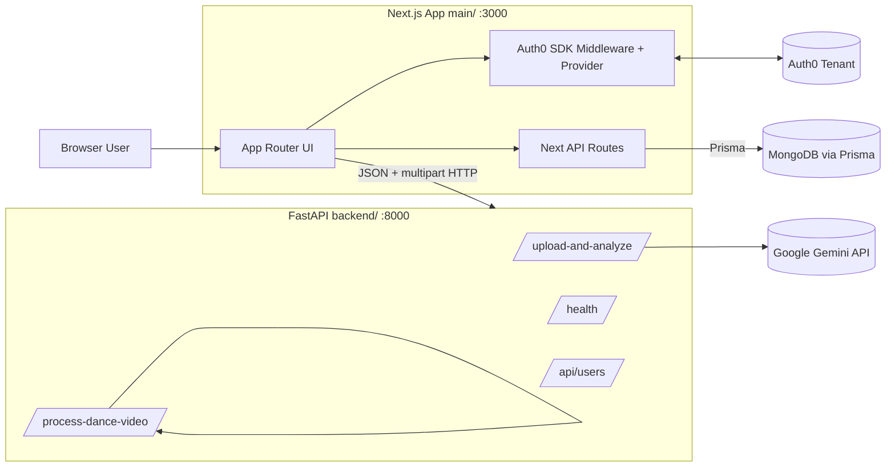
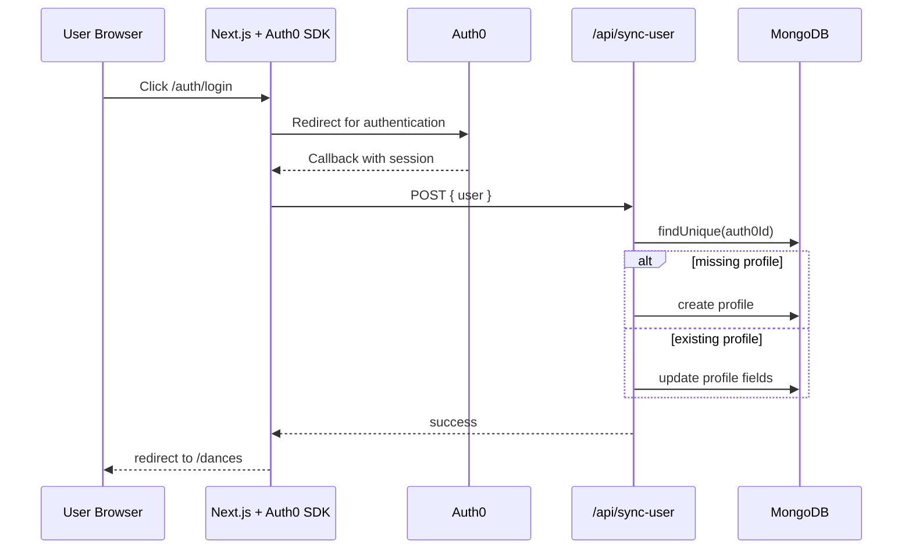
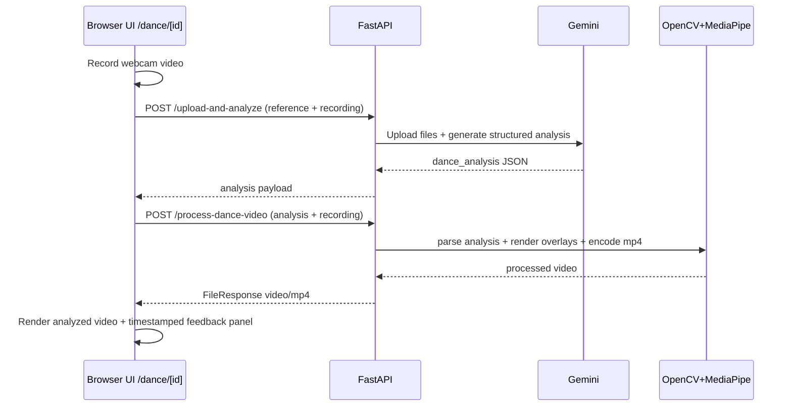

# LeetDance Technical Architecture

Generated on: 2026-02-09  
Repository: `HTN25`  
Purpose: engineering handoff document describing the current implemented architecture, operational behavior, and major risks.

## 1. Executive Summary

LeetDance is a two-service web application:

- A Next.js 15 frontend (`main/`) that provides UI, Auth0-based login/session handling, and limited server-side API routes for user profile sync and DB diagnostics.
- A FastAPI backend (`backend/`) that performs AI-assisted dance analysis and video annotation using Gemini + MediaPipe + OpenCV.

The project is functionally a prototype/MVP with strong demo capabilities but significant hardening gaps for production handoff:

- Core analysis pipeline is implemented and wired end-to-end.
- Authentication exists for identity/session UX, but business APIs are largely unauthenticated.
- Data model exists in Prisma (MongoDB), but only `Profile` is actively used in app flows.
- Several UI routes/features are stubs or dead links.

This document describes the current state as implemented in source, not an aspirational architecture.

## 2. System Context



## 3. Repository Topology

### 3.1 Top-level

- `main/`: Next.js frontend (App Router, React 19, Tailwind 4, Auth0 SDK, Prisma client)
- `backend/`: FastAPI service for analysis/video processing
- `docker-compose.yml`: local multi-container orchestration
- `DOCKER.md`: Docker usage documentation
- `README.md`: product/demo overview

### 3.2 Frontend key directories

- `main/app/`: App Router routes, pages, UI components
- `main/app/api/`: Next API route handlers (`sync-user`, `test-db`)
- `main/lib/auth0.js`: Auth0 client setup + callback hook
- `main/prisma/schema.prisma`: MongoDB schema
- `main/shadcn-components/ui/`: active shared UI primitives
- `main/public/videos`, `main/public/gifs`: static dance media assets

### 3.3 Backend key directories

- `backend/app/main.py`: main FastAPI app and all core analysis endpoints
- `backend/app/routers/users.py`: sample/in-memory users CRUD router
- `backend/app/config/settings.py`: pydantic settings
- `backend/test_*.py`: standalone script-style parser tests

## 4. Runtime Architecture by Layer

## 4.1 Frontend Architecture (`main/`)

### 4.1.1 Stack and runtime model

- Framework: Next.js `15.5.3` (App Router)
- React: `19.1.0`
- TypeScript strict mode enabled (`strict: true`)
- CSS: Tailwind CSS 4 + custom variables in `app/globals.css`
- Auth: `@auth0/nextjs-auth0` v4
- Data access in frontend APIs: Prisma Mongo client generated at `main/lib/generated/prisma`

### 4.1.2 Route inventory

Implemented pages:

- `/` (`main/app/page.tsx`): marketing landing page
- `/dances` (`main/app/dances/page.tsx`): dance catalog/list UI
- `/dance/[id]` (`main/app/dance/[id]/page.tsx`): record + submit + view analysis
- `/home` (`main/app/home/page.tsx`): legacy direct analyzer page
- `/profile` (`main/app/profile/page.tsx`): user profile dashboard

Implemented Next API routes:

- `POST /api/sync-user` (`main/app/api/sync-user/route.ts`)
- `GET /api/test-db` (`main/app/api/test-db/route.ts`)

Auth0 SDK-generated routes expected at runtime via SDK conventions:

- `/auth/login`, `/auth/logout`, `/auth/callback`, etc.

Referenced but not implemented page routes (broken navigation targets today):

- `/premium`, `/masterclass`, `/plans`, `/study-plan`, `/list/[id]`

### 4.1.3 Auth/session behavior

Core pieces:

- `middleware.ts` delegates all matched requests to `auth0.middleware(request)`.
- `layout.tsx` wraps app in `Auth0Provider`.
- `ProfileSection` and `profile/page.tsx` use `useUser()` for client-side auth state.
- `lib/auth0.js` defines `onCallback` hook to sync users into MongoDB via `/api/sync-user`.

Callback flow (as implemented):

1. Auth callback executes `onCallback`.
2. Logs callback/session details heavily.
3. Sends `{ user: session.user }` to `/api/sync-user`.
4. Redirects to `APP_BASE_URL` or `/dances`.

### 4.1.4 Data and state in UI

- Mostly local component state (`useState`, `useRef`, `useEffect`).
- No global client state manager (Redux/Zustand/etc).
- Dance list data is hardcoded in `dances/page.tsx`.
- Dance metadata mapping is duplicated in `dance/[id]/page.tsx`.

### 4.1.5 Frontend-to-backend integration

Browser calls FastAPI directly using hardcoded URLs:

- `http://localhost:8000/upload-and-analyze`
- `http://localhost:8000/process-dance-video`

Payloads:

- Analysis request: multipart form (`video1`, `video2`)
- Processing request: multipart form (`dance_analysis`, `video_file`)

### 4.1.6 UI/component structure notes

- Active UI primitives are imported from `main/shadcn-components/ui/*`.
- Duplicate UI folders exist at `main/components/ui` and `main/app/components/ui` (not used by app routes).
- Several pages/components are very large and combine view + orchestration logic (notably `dance/[id]/page.tsx`).

## 4.2 Frontend Server API Layer

## 4.2.1 `POST /api/sync-user`

Purpose:

- Upsert Auth0 user profile in MongoDB collection `profiles`.

Behavior:

- Requires `user.sub` and `user.email` in request body.
- `findUnique` by `auth0Id`.
- Create if missing, else update `name`, `picture`, `updatedAt`.

Storage dependency:

- Prisma client generated in `main/lib/generated/prisma`.
- MongoDB connection via `DATABASE_URL` from Prisma schema.

## 4.2.2 `GET /api/test-db`

Purpose:

- Debug endpoint to validate Mongo connection.

Behavior:

- Connects to DB, returns profile count and full profile list.
- Intended diagnostic endpoint, currently open.

## 4.3 Backend Architecture (`backend/`)

### 4.3.1 Stack

- FastAPI
- Uvicorn
- `google-genai`
- OpenCV (`cv2`)
- MediaPipe Pose
- NumPy + Pillow
- `python-multipart` for upload handling

### 4.3.2 App composition

`backend/app/main.py` contains:

- App factory (`create_app`)
- CORS middleware setup
- Users router registration (`app.include_router(users.router)`)
- Main analysis/processing endpoints
- Health and structured-output test endpoints

### 4.3.3 API inventory

Core endpoints:

- `GET /`: service banner/version
- `POST /upload-and-analyze`: upload two videos, call Gemini, return structured analysis
- `POST /process-dance-video`: parse analysis + annotate uploaded video, return processed mp4
- `GET /health`: liveness
- `POST /test-structured-output`: Gemini structured output diagnostic

Users sample endpoints (demo/in-memory):

- `GET /api/users/`
- `GET /api/users/{user_id}`
- `POST /api/users/`
- `DELETE /api/users/{user_id}`

### 4.3.4 `/upload-and-analyze` pipeline

1. Accepts two uploaded files (`video1`, `video2`).
2. Saves both to temp files.
3. Uploads files to Gemini file API.
4. Polls until both files are `ACTIVE`.
5. Sends prompt + files to model `gemini-2.0-flash-001` with structured schema (`DanceAnalysisResponse`).
6. Returns payload:
- `response` raw JSON text
- `parsed_data.dance_analysis[]` normalized objects
7. Cleans temp files in `finally`.

Structured model item fields:

- `timestamp_of_outcome`
- `result` (`reference` or `recording`)
- `feedback`
- `score` (int)
- `problem_type`

### 4.3.5 `/process-dance-video` pipeline

1. Accepts multipart fields:
- `dance_analysis`: string (JSON or JSON-like text)
- `video_file`: uploaded user video
2. Parses analysis with multi-strategy fallback:
- direct JSON parse
- `parsed_data` extraction
- regex block extraction
- timestamp heuristic fallback
- mock fallback payload
3. Saves input video to temp file.
4. Opens two OpenCV capture handles on same input (process/display).
5. Runs MediaPipe Pose per frame.
6. Builds `dance_events` grouped by timestamp and overlays contextual feedback text on frames.
7. Stores all processed frames in memory, then writes to output mp4.
8. Attempts H.264 (`avc1`) writer first, falls back to `mp4v` + optional ffmpeg transcode.
9. Validates output by reopening and reading first frame.
10. Returns `FileResponse` with `video/mp4`.
11. Cleans temp input file.

### 4.3.6 CORS and networking

CORS allows local frontend origins (`localhost:3000`, `127.0.0.1:3000`, plus settings list).

Frontend browser requests backend directly, so backend CORS is mandatory for local flow.

## 5. Data Architecture

## 5.1 Persistence model (Prisma + MongoDB)

Defined models:

- `Profile`
- `Dance`
- `DanceAttempt`

Relations:

- `Profile` 1-N `DanceAttempt`
- `Dance` 1-N `DanceAttempt`

Current usage in app:

- Active usage: `Profile` via `/api/sync-user` and `/api/test-db`.
- Not actively used by route handlers: `Dance`, `DanceAttempt`.
- Dance catalog in UI currently hardcoded, not loaded from DB.

## 5.2 Ownership boundaries

- Identity/profile persistence: Next API layer (`main/app/api/*`) via Prisma.
- AI/media analysis: FastAPI backend does not write to MongoDB currently.
- No shared transaction boundary between frontend API and backend processing.

## 6. End-to-End Flow Specifications

## 6.1 Login and profile sync



## 6.2 Dance analysis and processed video



## 7. Deployment and Runtime Topology

## 7.1 Docker Compose (`docker-compose.yml`)

Services:

- `backend`
- Build context: `./backend`
- Host port: `8000:8000`
- Reads env from `./backend/.env`
- Mounts source for live reload (`./backend:/app`)

- `frontend`
- Build context: `./main`
- Host port: `3000:3000`
- Reads env from `./main/.env.local`
- Depends on backend service

Shared network:

- `leetdance-network` (bridge)

## 7.2 Frontend container build

- Multi-stage Node 20 Alpine build
- Runs `npx prisma generate`
- Builds Next standalone output
- Copies `.next/standalone`, static assets, and generated Prisma client into runtime image

## 7.3 Backend container build

- Python 3.11 slim
- Installs system libs needed for OpenCV
- Runs uvicorn with `--reload`

## 8. Configuration and Secrets Matrix

Expected/used variables (current implementation):

Frontend/Auth0/Next:

- `AUTH0_DOMAIN` (SDK default env loading)
- `AUTH0_CLIENT_ID`
- `AUTH0_CLIENT_SECRET`
- `AUTH0_SECRET`
- `APP_BASE_URL` (callback sync URL + redirect)
- `AUTH0_SCOPE` (optional authorization params)
- `AUTH0_AUDIENCE` (optional authorization params)
- `DATABASE_URL` (Prisma Mongo connection)

Backend:

- `GEMINI_KEY` (required for Gemini calls)
- `allowed_origins` via settings/env (optional override)

Operational note:

- Repository references `.env.example` files in docs, but example env files are not present in current tree.

## 9. Observability and Operational Behavior

Current behavior:

- Heavy debug logging in frontend API routes, Auth0 callback, frontend pages, and backend processing.
- Backend logs include detailed parse/codec/debug traces.
- No centralized logging, metrics, traces, or log redaction.
- No explicit request IDs or correlation IDs.

Health surface:

- `GET /health` exists for backend liveness.

Missing operations capabilities:

- No readiness endpoint semantics beyond basic liveness.
- No queue/async job model for long-running video operations.
- No retry/backoff policy at frontend for backend failures.

## 10. Security Posture (Current State)

Strengths:

- Auth0 integration for user identity/session in frontend.
- Prisma schema defines stable profile ownership key (`auth0Id`).

Gaps and risks:

- Backend analysis endpoints are unauthenticated.
- `/api/test-db` exposes full profile records and is unauthenticated.
- Extensive logging includes user/session/profile and debugging details.
- No explicit upload size limits, malware scanning, or abuse/rate limiting.
- No CSRF/rate-limit protections around profile sync endpoint.

## 11. Performance Characteristics

Primary computational hotspot:

- `process-dance-video` is CPU-intensive and synchronous.

Memory hotspot:

- Processed frames are accumulated in `processed_frames` list before write-out, scaling memory linearly with video duration and resolution.

Potential bottlenecks:

- Single worker blocking during OpenCV processing.
- Gemini upload + generation latency in request path.
- Re-encoding/transcoding path with ffmpeg can significantly increase tail latency.

## 12. Known Issues and Technical Debt

Priority 0 (production blockers):

- Unauthenticated sensitive endpoint: `/api/test-db` returns all profiles.
- Unauthenticated analysis endpoints allow unrestricted compute usage.
- High-verbosity logs can expose PII and internals.

Priority 1 (reliability/behavior):

- Frontend hardcodes backend URL `http://localhost:8000`.
- Route links point to non-existent pages (`/premium`, `/plans`, etc.).
- `Slide.mp4` referenced in code, file present as `Slide.MP4` (case mismatch risk on Linux).
- Dance navigation max ID is `21` while data includes ID `22`.
- Score semantics mismatch:
- Gemini prompt says scores are `-10..10`.
- Backend logic checks `score >= 70` for "good performance" animation.
- Frontend aggregate score sums per-move transformed values; not normalized.

Priority 2 (maintainability):

- Monolithic backend file (`backend/app/main.py`, ~961 lines).
- Duplicate UI component trees (`main/shadcn-components/ui`, `main/components/ui`, `main/app/components/ui`).
- Dance catalog data duplicated in multiple places instead of shared source.

## 13. Recommended Target Refactor Plan

## 13.1 API and service boundaries

1. Move backend URL to environment-driven config (`NEXT_PUBLIC_BACKEND_URL`).
2. Add authN/authZ to analysis endpoints (JWT/session-based).
3. Replace synchronous video endpoint with async job pattern:
- enqueue processing
- poll/stream status
- fetch final artifact

## 13.2 Data model activation

1. Persist dance catalog in `Dance` collection.
2. Persist per-user attempts/results in `DanceAttempt`.
3. Replace hardcoded frontend arrays with server-fetched data.

## 13.3 Reliability and observability

1. Introduce structured logging and redact PII.
2. Add request IDs across frontend API and backend.
3. Enforce upload size/time limits.
4. Add error taxonomy and frontend retries for transient failures.

## 13.4 Code organization

1. Split backend into modules:
- `routers/analysis.py`
- `services/gemini_service.py`
- `services/video_processing.py`
- `schemas/analysis.py`
2. Remove duplicate UI directories and standardize imports.
3. Extract shared dance metadata catalog into single source file or DB.

## 14. Local Development and Handoff Runbook

## 14.1 Prerequisites

- Node.js 20+
- Python 3.11+
- MongoDB instance
- Auth0 tenant/app credentials
- Gemini API key
- ffmpeg (recommended for codec fallback path)

## 14.2 Run with Docker

```bash
docker-compose up --build
```

Access:

- Frontend: `http://localhost:3000`
- Backend: `http://localhost:8000`
- Backend docs: `http://localhost:8000/docs`

## 14.3 Run without Docker

Frontend:

```bash
cd main
npm ci
npx prisma generate
npm run dev
```

Backend:

```bash
cd backend
python3 -m venv venv
source venv/bin/activate
pip install -r requirements.txt
uvicorn app.main:app --reload --host 0.0.0.0 --port 8000
```

## 14.4 Suggested smoke checks

1. `GET http://localhost:8000/health` returns healthy.
2. Login flow reaches `/dances` and creates/updates profile via `/api/sync-user`.
3. Analyze a short sample dance and verify processed video playback.
4. Verify route navigation only to implemented pages or add placeholders.

## 15. File-Level Ownership Map for Handoff

Frontend core:

- App shell and auth provider: `main/app/layout.tsx`
- Middleware: `main/middleware.ts`
- Auth client and callback: `main/lib/auth0.js`
- Dance list UI: `main/app/dances/page.tsx`
- Dance execution/analysis UI: `main/app/dance/[id]/page.tsx`
- Profile UI: `main/app/profile/page.tsx`
- User sync API: `main/app/api/sync-user/route.ts`

Backend core:

- Main API and video pipeline: `backend/app/main.py`
- Settings: `backend/app/config/settings.py`
- Users sample router: `backend/app/routers/users.py`

Data layer:

- Prisma schema: `main/prisma/schema.prisma`

Infra:

- Compose: `docker-compose.yml`
- Frontend image: `main/Dockerfile`
- Backend image: `backend/Dockerfile`

## 16. Final Assessment

This repository is a strong hackathon-grade vertical slice with real AI/video functionality and polished UI direction. For reliable handoff into sustained development, the highest-value next actions are:

1. secure and gate backend/data endpoints,
2. remove hardcoded environment assumptions,
3. modularize the backend processing pipeline,
4. connect persisted models (`Dance`, `DanceAttempt`) to runtime flows,
5. clean dead routes and duplicated component trees.

